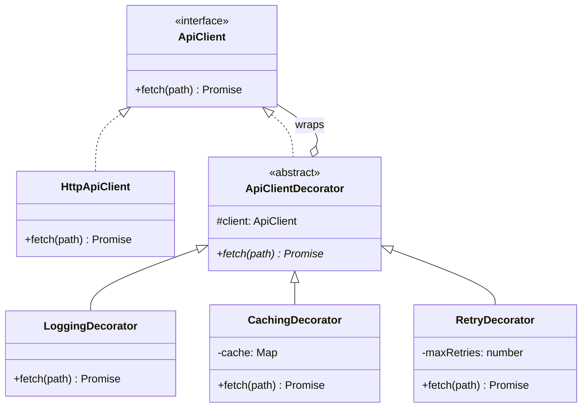

# Dekorator andozasi (Decorator)

<CoverImage src="/covers/structural/decorator.webp" alt="Cover">
  <h1>Dekorator</h1>
  <p>Haddan tashqari ko'p qavat qishki kiyim kiyib olgan kulgili kichkina oq robot: sharf, shapka, nurli quloqchinlar, qalin kurtka va qor poyabzallari — asosiy robotni o'zgartirmasdan unga imkoniyatlar qo'shilmoqda.</p>
</CoverImage>

## Umumiy ko'rinish (Overview)

**Dekorator (Decorator)** — bu obyektni xuddi shu interfeysni amalga oshiruvchi boshqa obyektga o'rash orqali unga dinamik ravishda xatti-harakat qo'shadigan tuzilmaviy (structural) loyihalash andozasidir. Har bir dekorator chaqiruvni o'ralgan komponentga uzatadi va chaqiruvdan oldin yoki keyin o'z ishini qo'shadi.

**Asosiy afzalligi**: Quyi klasslar portlashisiz (subclass explosion) ish vaqtida (runtime) mas'uliyatlarni qatlam-qatlam qo'shishingiz mumkin.

**Zamonaviy nuqtai nazar**: Bugungi kunda Dekorator production kodida hamma joyda uchraydi: middleware, stream o'ramlari, HTTP klientlar, keshlash qatlamlari, loglash qatlamlari, qayta urinish (retry) siyosatlari va xavfsizlik o'ramlari.

Dekorator xatti-harakat qo'shadi. U mos kelmaydigan interfeyslarni tarjima qilmaydi.

## Hayotiy o'xshatish (Real-World Analogy)

**Kiyimlarni qavatma-qavat kiyishni** tasavvur qiling. Ko'ylak o'zi ham yetarli, lekin ob-havoga qarab ustidan kurtka, yomg'irpo'sh yoki sharf qo'shishingiz mumkin. Har bir qavat ostidagi tanani o'zgarishsiz qoldiradi, lekin umumiy natijani o'zgartiradi.

Dekoratorlar aynan shunday qiladi: har bir qavat asl obyektni o'zgartirmasdan unga nimadir qo'shadi.

## Tuzilma (Structure)



- **`ApiClient`** (Component) — asosiy obyekt va har bir o'ram uchun umumiy interfeys.
- **`HttpApiClient`** (Concrete Component) asosiy xatti-harakatni ta'minlaydi.
- **`ApiClientDecorator`** (Base Decorator) `ApiClient`'ni amalga oshiradi va o'ralgan `ApiClient`'ni saqlaydi, shuning uchun dekoratorlarni ustma-ust qo'yish mumkin.
- **`LoggingDecorator` / `CachingDecorator` / `RetryDecorator`** (Concrete Decorators) chaqiruvni uzatishdan oldin yoki keyin har biri bittadan xatti-harakat qo'shadi.

## Muammo (The Problem)

Faraz qilaylik, sizda oddiy API klient bor, lekin turli chaqiruv joylariga loglash, keshlash, qayta urinishlar va metrikalarning turli kombinatsiyalari kerak.

Agar merosdan foydalansangiz, tezda klasslar portlashiga duch kelasiz:

- BasicClient
- LoggedClient
- CachedClient
- RetryingClient
- LoggedCachedClient
- LoggedRetryingClient
- CachedRetryingClient
- LoggedCachedRetryingClient

Imkoniyatlar ko'paygan sari bu juda yomon o'sadi.

### Muammo misoli

```typescript
// ❌ Yomon: vorislik kombinatorikasi
class LoggedCachedRetryingApiClient extends ApiClient {}
class CachedRetryingApiClient extends ApiClient {}
class LoggedApiClient extends ApiClient {}
```

## Yechim (The Solution)

Dekorator obyektni o'rab, xuddi shu interfeysni saqlab qolish orqali bu muammoni hal qiladi.

1. Umumiy komponent interfeysini aniqlang
2. Asosiy obyektni bir marta amalga oshiring
3. Har bir xatti-harakat uchun bittadan dekorator klass qo'shing
4. Ish vaqtida dekoratorlarni kerakli tarzda birlashtiring (compose)

Bu asosiy obyektni sodda saqlaydi va imkoniyatlarni faqat kerakli joyda qo'shish imkonini beradi.

## Amalga oshirish (Implementation)

::: code-group

```typescript [TypeScript]
interface ApiClient {
  fetch(path: string): Promise<string>;
}

class HttpApiClient implements ApiClient {
  async fetch(path: string): Promise<string> {
    return `response from ${path}`;
  }
}

abstract class ApiClientDecorator implements ApiClient {
  constructor(protected readonly client: ApiClient) {}
  abstract fetch(path: string): Promise<string>;
}

class LoggingDecorator extends ApiClientDecorator {
  async fetch(path: string): Promise<string> {
    console.log(`[LOG] fetching ${path}`);
    const result = await this.client.fetch(path);
    console.log(`[LOG] received ${result}`);
    return result;
  }
}

class CachingDecorator extends ApiClientDecorator {
  private cache = new Map<string, string>();

  async fetch(path: string): Promise<string> {
    if (this.cache.has(path)) {
      console.log(`[CACHE] hit for ${path}`);
      return this.cache.get(path)!;
    }

    const result = await this.client.fetch(path);
    this.cache.set(path, result);
    return result;
  }
}

class RetryDecorator extends ApiClientDecorator {
  constructor(
    client: ApiClient,
    private readonly maxRetries: number = 3,
  ) {
    super(client);
  }

  async fetch(path: string): Promise<string> {
    let lastError: unknown;

    for (let attempt = 1; attempt <= this.maxRetries; attempt++) {
      try {
        return await this.client.fetch(path);
      } catch (error) {
        lastError = error;
        console.log(`[RETRY] attempt ${attempt} failed`);
      }
    }

    throw lastError;
  }
}

const client: ApiClient = new LoggingDecorator(
  new RetryDecorator(new CachingDecorator(new HttpApiClient())),
);

client.fetch("/users");
```

```python [Python]
from abc import ABC, abstractmethod

class ApiClient(ABC):
    @abstractmethod
    def fetch(self, path: str) -> str:
        pass

class HttpApiClient(ApiClient):
    def fetch(self, path: str) -> str:
        return f"response from {path}"

class ApiClientDecorator(ApiClient):
    def __init__(self, client: ApiClient):
        self._client = client

class LoggingDecorator(ApiClientDecorator):
    def fetch(self, path: str) -> str:
        print(f"[LOG] fetching {path}")
        result = self._client.fetch(path)
        print(f"[LOG] received {result}")
        return result

class CachingDecorator(ApiClientDecorator):
    def __init__(self, client: ApiClient):
        super().__init__(client)
        self._cache = {}

    def fetch(self, path: str) -> str:
        if path in self._cache:
            print(f"[CACHE] hit for {path}")
            return self._cache[path]
        result = self._client.fetch(path)
        self._cache[path] = result
        return result

class RetryDecorator(ApiClientDecorator):
    def __init__(self, client: ApiClient, max_retries: int = 3):
        super().__init__(client)
        self._max_retries = max_retries

    def fetch(self, path: str) -> str:
        last_error = None
        for attempt in range(1, self._max_retries + 1):
            try:
                return self._client.fetch(path)
            except Exception as error:
                last_error = error
                print(f"[RETRY] attempt {attempt} failed")
        raise last_error

client = LoggingDecorator(RetryDecorator(CachingDecorator(HttpApiClient())))
print(client.fetch("/users"))
```

```java [Java]
interface ApiClient {
    String fetch(String path);
}

class HttpApiClient implements ApiClient {
    @Override
    public String fetch(String path) {
        return "response from " + path;
    }
}

abstract class ApiClientDecorator implements ApiClient {
    protected final ApiClient client;

    protected ApiClientDecorator(ApiClient client) {
        this.client = client;
    }
}

class LoggingDecorator extends ApiClientDecorator {
    LoggingDecorator(ApiClient client) {
        super(client);
    }

    @Override
    public String fetch(String path) {
        System.out.println("[LOG] fetching " + path);
        String result = client.fetch(path);
        System.out.println("[LOG] received " + result);
        return result;
    }
}

class CachingDecorator extends ApiClientDecorator {
    private final java.util.Map<String, String> cache = new java.util.HashMap<>();

    CachingDecorator(ApiClient client) {
        super(client);
    }

    @Override
    public String fetch(String path) {
        if (cache.containsKey(path)) {
            System.out.println("[CACHE] hit for " + path);
            return cache.get(path);
        }
        String result = client.fetch(path);
        cache.put(path, result);
        return result;
    }
}

class RetryDecorator extends ApiClientDecorator {
    private final int maxRetries;

    RetryDecorator(ApiClient client, int maxRetries) {
        super(client);
        this.maxRetries = maxRetries;
    }

    @Override
    public String fetch(String path) {
        RuntimeException last = null;
        for (int attempt = 1; attempt <= maxRetries; attempt++) {
            try {
                return client.fetch(path);
            } catch (RuntimeException error) {
                last = error;
                System.out.println("[RETRY] attempt " + attempt + " failed");
            }
        }
        throw last;
    }
}
```

```go [Go]
package main

import "fmt"

type ApiClient interface {
  Fetch(path string) (string, error)
}

type HttpApiClient struct{}

func (c *HttpApiClient) Fetch(path string) (string, error) {
  return "response from " + path, nil
}

type ApiClientDecorator struct {
	client ApiClient
}

type LoggingDecorator struct {
	ApiClientDecorator
}

func (d *LoggingDecorator) Fetch(path string) (string, error) {
	fmt.Println("[LOG] fetching", path)
  result, err := d.client.Fetch(path)
  if err != nil {
    return "", err
  }
	fmt.Println("[LOG] received", result)
  return result, nil
}

type CachingDecorator struct {
	ApiClientDecorator
	cache map[string]string
}

func NewCachingDecorator(client ApiClient) *CachingDecorator {
	return &CachingDecorator{
		ApiClientDecorator: ApiClientDecorator{client: client},
		cache:              make(map[string]string),
	}
}

func (d *CachingDecorator) Fetch(path string) (string, error) {
	if value, ok := d.cache[path]; ok {
		fmt.Println("[CACHE] hit for", path)
    return value, nil
	}
  result, err := d.client.Fetch(path)
  if err != nil {
    return "", err
  }
	d.cache[path] = result
  return result, nil
}

type RetryDecorator struct {
  ApiClientDecorator
  maxRetries int
}

func (d *RetryDecorator) Fetch(path string) (string, error) {
  var lastErr error
  for attempt := 1; attempt <= d.maxRetries; attempt++ {
    result, err := d.client.Fetch(path)
    if err == nil {
      return result, nil
    }
    lastErr = err
    fmt.Println("[RETRY] attempt", attempt, "failed")
  }
  return "", lastErr
}
```

```rust [Rust]
use std::collections::HashMap;

trait ApiClient {
    fn fetch(&mut self, path: &str) -> String;
}

struct HttpApiClient;

impl ApiClient for HttpApiClient {
    fn fetch(&mut self, path: &str) -> String {
        format!("response from {}", path)
    }
}

struct LoggingDecorator<T: ApiClient> {
    client: T,
}

impl<T: ApiClient> LoggingDecorator<T> {
    fn new(client: T) -> Self {
        Self { client }
    }
}

impl<T: ApiClient> ApiClient for LoggingDecorator<T> {
    fn fetch(&mut self, path: &str) -> String {
        println!("[LOG] fetching {}", path);
        let result = self.client.fetch(path);
        println!("[LOG] received {}", result);
        result
    }
}

struct CachingDecorator<T: ApiClient> {
    client: T,
    cache: HashMap<String, String>,
}

impl<T: ApiClient> CachingDecorator<T> {
    fn new(client: T) -> Self {
        Self {
            client,
            cache: HashMap::new(),
        }
    }
}

impl<T: ApiClient> ApiClient for CachingDecorator<T> {
    fn fetch(&mut self, path: &str) -> String {
        if let Some(value) = self.cache.get(path) {
            println!("[CACHE] hit for {}", path);
            return value.clone();
        }

        let result = self.client.fetch(path);
        self.cache.insert(path.to_string(), result.clone());
        result
    }
}
```

:::

## Haqiqiy hayotdagi misol (Real-World Example)

Dekoratorning production'dagi keng tarqalgan qo'llanilishi — HTTP klientni loglash, keshlash yoki qayta urinish xatti-harakati bilan o'rash. Har bir vazifa alohida qoladi va o'ramlar zanjiri faqat kerakli joyda yig'iladi.

```typescript
const client: ApiClient = new LoggingDecorator(
  new RetryDecorator(new CachingDecorator(new HttpApiClient())),
);
```

Bu asosiy klientni qayta ishlatiladigan holda saqlaydi va barcha kesishuvchi vazifalarni (cross-cutting concerns) bitta klassga qattiq yozib qo'yishdan qochadi.

## Afzalliklari (Advantages)

- Asosiy klassni o'zgartirmasdan xatti-harakat qo'shadi
- Meros portlashining oldini oladi
- Imkoniyatlarni ish vaqtida birlashtirishni qo'llab-quvvatlaydi
- Mas'uliyatlarni kichik o'ramlarga ajratilgan holda saqlaydi
- Kesishuvchi vazifalarni qayta ishlatiladigan qiladi
- Xatti-harakatni faqat kerakli joyda qo'llash imkonini beradi

## Kamchiliklari (Disadvantages)

- Ko'plab kichik o'ram obyektlarini yaratishi mumkin
- Chuqur dekorator zanjirlarini debug qilish qiyinroq bo'lishi mumkin
- O'rash tartibi muhim
- Juda ko'p xatti-harakatlar ustma-ust qo'yilsa, chalkash bo'lib qolishi mumkin
- Barcha qatlamlar uchun umumiy interfeysni talab qiladi

## Qachon foydalanish kerak (When to Use)

- Sizga ixtiyoriy xatti-harakat qatlamlari kerak
- Loglash yoki keshlash kabi kesishuvchi vazifalarni qo'shmoqchisiz
- Quyi klass kombinatsiyalaridan qochmoqchisiz
- Sizga ish vaqtida birlashtirish kerak
- Bir xil asosiy obyekt ko'plab kontekstlarga xizmat qilishini xohlaysiz

## Qachon foydalanmaslik kerak (When NOT to Use)

- Xatti-harakat qat'iy belgilangan va sodda bo'lishi kerak
- O'ramlar zanjirini tushunish juda qiyin bo'lib qoladi
- Qo'shimcha bilvositalik (indirection) moslashuvchanlikka arzimaydi
- Xatti-harakat asosiy obyektning o'ziga tegishli
- Sizga xatti-harakat qatlamlari emas, balki interfeys tarjimasi kerak

## Keng tarqalgan xatolar (Common Mistakes)

### 1-xato: Interfeysni o'zgartirish

```typescript
// ❌ Yomon: endi haqiqiy dekorator emas
class BadDecorator {
  logFetch() {}
}

// ✅ Yaxshi: o'sha interfeysni saqlang
class LoggingDecorator implements ApiClient {
  fetch(path: string): Promise<string> {
    return Promise.resolve(path);
  }
}
```

### 2-xato: O'ramlarga aloqasiz ishlarni yuklash

```typescript
// ❌ Yomon: dekorator biznes qoidalarini boshqaradi
class BadDecorator {
  fetch(path: string) {
    // narxlash mantiqi shu yerda
  }
}

// ✅ Yaxshi: dekorator faqat bitta vazifani qo'shadi
```

### 3-xato: O'rash tartibini e'tiborsiz qoldirish

```typescript
// ❌ Yomon: retry tashqarisidagi kesh xatolarni noto'g'ri keshlashi mumkin
// ✅ Yaxshi: tartibni ongli ravishda tanlang
```

### 4-xato: Har bir kichik o'zgarish uchun dekoratorlardan ortiqcha foydalanish

```typescript
// ❌ Yomon: o'nlab bir martalik wrapperlar
// ✅ Yaxshi: dekoratorlarni mazmunli kesishuvchi vazifalar uchun ishlating
```

## Aloqador andozalar (Related Patterns)

- **[Adapter](/uz/structural/adapter)**: Xatti-harakatni emas, interfeys mosligini o'zgartiradi
- **[O'rinbosar](/uz/structural/proxy)**: Kirishni nazorat qiladi; tashqi ko'rinishi o'xshash bo'lishi mumkin, lekin maqsadi boshqa
- **[Fasad](/uz/structural/facade)**: Xatti-harakatni o'rash o'rniga quyi tizimga kirishni soddalashtiradi
- **[Mas'uliyatlar zanjiri](/uz/behavioral/chain-of-responsibility)**: Barcha xatti-harakatlarni bitta obyekt ustiga qatlamlash o'rniga so'rovlarni handler'lar orqali o'tkazadi

## Zamonaviy muqobillar (Modern Alternatives)

- Veb-freymvorklardagi middleware quvurlari (pipeline)
- HTTP klientlardagi interceptor'lar
- Aspektga yo'naltirilgan dasturlash (AOP)
- Yuqori tartibli funksiyalar (higher-order functions) bilan funksional kompozitsiya
- Reaktiv operatorlar zanjirlari

## Intervyu uchun maslahatlar (Interview Insights)

**1-savol: Dekorator nimani hal qiladi?**

J: U quyi klass yaratmasdan dinamik ravishda xatti-harakat qo'shish imkonini beradi. Uning mavjudligining asosiy sababi shu.

**2-savol: Dekorator O'rinbosardan nimasi bilan farq qiladi?**

J: O'rinbosar kirishni yoki hayot siklini nazorat qiladi. Dekorator esa mas'uliyatlar va xatti-harakat qo'shadi.

**3-savol: Nega ixtiyoriy imkoniyatlar uchun Dekorator quyi klasslardan yaxshiroq?**

J: Chunki quyi klass kombinatsiyalari eksponensial o'sadi. Dekoratorlar esa buning o'rniga imkoniyatlarni ish vaqtida birlashtiradi.

**4-savol: Nega dekoratorlar tartibi muhim?**

J: Chunki har bir qatlam oldingi qatlamning natijasini ko'radi. Retry'ni o'rab turgan kesh keshni o'rab turgan retry'dan boshqacha ishlaydi.

**5-savol: Qachon Dekorator ortiqcha bo'ladi?**

J: Faqat bitta yoki ikkita oddiy variatsiya bo'lsa va to'g'ridan-to'g'ri metod yoki oddiy yordamchi funksiya yetarli bo'lsa.
