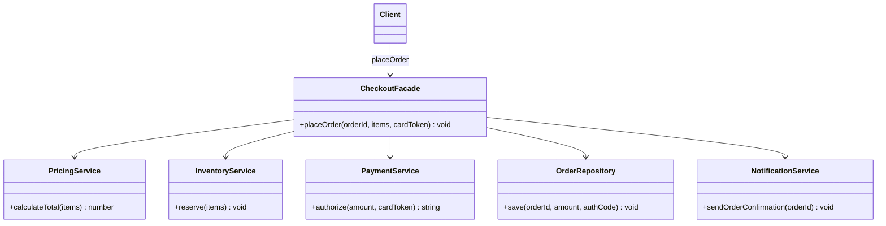

# Fasad andozasi (Facade)

<CoverImage src="/covers/structural/facade.webp" alt="Cover">
  <h1>Fasad</h1>
  <p>Kutib oluvchi qizil gilam va uning oldida turgan do'stona robot-xizmatkor bilan go'zal, beg'ubor qal'a devori fasadi — u devor ortidagi yovvoyi simlar, aylanayotgan tishli g'ildiraklar va tutundan iborat mutlaq tartibsizlikni butunlay yashirib turibdi.</p>
</CoverImage>

## Umumiy ko'rinish (Overview)

**Fasad (Facade)** — bu murakkab quyi tizimga (subsystem) sodda, yuqori darajadagi interfeys taqdim etuvchi tuzilmaviy (structural) loyihalash andozasidir. U quyi tizimni olib tashlamaydi; shunchaki mijozlarga toza kirish nuqtasini beradi, shunda ular har bir ichki servisni o'zlari muvofiqlashtirishlari shart bo'lmaydi.

**Asosiy afzalligi**: Bog'liqlikni (coupling) kamaytiradi va mijoz kodini ko'plab harakatlanuvchi qismlar o'rniga bitta niyatga yo'naltirilgan holda saqlaydi.

**Zamonaviy nuqtai nazar**: Fasad hali ham API orkestratsiyasida, SDK o'ramlarida, checkout oqimlarida, autentifikatsiya oqimlarida va domen servislarini muvofiqlashtirishda keng qo'llaniladi. Bu kundalik ilova kodidagi eng amaliy tuzilmaviy andozalardan biri.

Fasad mos kelmaydigan interfeyslarni tarjima qilish haqida emas. U **kirishni soddalashtirish** haqida.

## Hayotiy o'xshatish (Real-World Analogy)

**Mehmonxonadagi qabulxonani (resepshn)** tasavvur qiling. Mehmonlar xona tozalash, xavfsizlik, hisob-kitob, texnik xizmat va xonaga xizmat ko'rsatish bo'limlari bilan alohida gaplashishlari shart emas. Ular qabulxonaga nima kerakligini aytadilar, qolganini esa qabulxona muvofiqlashtiradi.

Bu fasad: ko'plab ichki tizimlar ustidagi bitta sodda interfeys.

## Tuzilma (Structure)



- **`CheckoutFacade`** (Facade) bitta yuqori darajadagi metodni taqdim etadi va quyi tizim chaqiruvlarini to'g'ri tartibda orkestratsiya qiladi.
- **`PricingService`, `InventoryService`, `PaymentService`, `OrderRepository`, `NotificationService`** (Subsystem classes) haqiqiy ishni bajaradi va fasad haqida hech narsa bilmaydi.
- **`Client`** faqat fasadni chaqiradi, biroq nozikroq nazorat kerak bo'lganda quyi tizimlar baribir ochiq qoladi.

## Muammo (The Problem)

Zamonaviy checkout oqimi ko'pincha bir nechta servislarga murojaat qiladi:

- narx va soliqni hisoblash
- omborda mahsulotni band qilish (inventory reservation)
- to'lovni avtorizatsiya qilish
- buyurtmani saqlash
- bildirishnomalarni yetkazish

Agar har bir controller yoki UI amali bularning hammasini qo'lda orkestratsiya qilishi kerak bo'lsa, kod mo'rt va takroriy bo'lib qoladi.

### Muammo misoli

```typescript
// ❌ Yomon: controller quyi tizim haqida juda ko'p biladi
const pricing = new PricingService();
const inventory = new InventoryService();
const payment = new PaymentService();
const orders = new OrderRepository();

const total = pricing.calculate(cart);
inventory.reserve(cart.items);
payment.authorize(card, total);
orders.saveOrder(cart, total);
```

Buni test qilish, qayta ishlatish va xavfsiz o'zgartirish qiyin.

## Yechim (The Solution)

Fasad orkestratsiyani alohida klassga ko'chirish orqali bu muammoni hal qiladi.

1. Mijoz bitta fasad metodi bilan muloqot qiladi
2. Fasad quyi tizim chaqiruvlarini muvofiqlashtiradi
3. To'g'ridan-to'g'ri kirish hali ham kerak bo'lsa, quyi tizim klasslari mavjudligicha qoladi

Natijada chegarada soddaroq API va butun ilova bo'ylab kamroq bog'liqlik hosil bo'ladi.

## Amalga oshirish (Implementation)

::: code-group

```typescript [TypeScript]
class PricingService {
  calculateTotal(items: { price: number; quantity: number }[]): number {
    return items.reduce((sum, item) => sum + item.price * item.quantity, 0);
  }
}

class InventoryService {
  reserve(items: { sku: string; quantity: number }[]): void {
    console.log(`Reserving ${items.length} line items`);
  }
}

class PaymentService {
  authorize(amount: number, cardToken: string): string {
    console.log(`Authorizing payment for $${amount.toFixed(2)}`);
    return `auth_${Date.now()}`;
  }
}

class OrderRepository {
  save(orderId: string, amount: number, authCode: string): void {
    console.log(`Saving order ${orderId} with auth ${authCode}`);
  }
}

class NotificationService {
  sendOrderConfirmation(orderId: string): void {
    console.log(`Sending confirmation for ${orderId}`);
  }
}

class CheckoutFacade {
  constructor(
    private readonly pricing: PricingService,
    private readonly inventory: InventoryService,
    private readonly payment: PaymentService,
    private readonly orders: OrderRepository,
    private readonly notifications: NotificationService,
  ) {}

  placeOrder(
    orderId: string,
    items: { price: number; quantity: number; sku: string }[],
    cardToken: string,
  ): void {
    const total = this.pricing.calculateTotal(items);
    this.inventory.reserve(
      items.map(({ sku, quantity }) => ({ sku, quantity })),
    );
    const authCode = this.payment.authorize(total, cardToken);
    this.orders.save(orderId, total, authCode);
    this.notifications.sendOrderConfirmation(orderId);
  }
}

const checkout = new CheckoutFacade(
  new PricingService(),
  new InventoryService(),
  new PaymentService(),
  new OrderRepository(),
  new NotificationService(),
);

checkout.placeOrder(
  "order_123",
  [
    { sku: "book-1", price: 19.99, quantity: 2 },
    { sku: "bag-4", price: 49.5, quantity: 1 },
  ],
  "tok_abc",
);
```

```python [Python]
class PricingService:
    def calculate_total(self, items):
        return sum(item["price"] * item["quantity"] for item in items)

class InventoryService:
    def reserve(self, items):
        print(f"Reserving {len(items)} line items")

class PaymentService:
    def authorize(self, amount, card_token):
        print(f"Authorizing payment for ${amount:.2f}")
        return f"auth_{int(amount * 100)}"

class OrderRepository:
    def save(self, order_id, amount, auth_code):
        print(f"Saving order {order_id} with auth {auth_code}")

class NotificationService:
    def send_order_confirmation(self, order_id):
        print(f"Sending confirmation for {order_id}")

class CheckoutFacade:
    def __init__(self, pricing, inventory, payment, orders, notifications):
        self._pricing = pricing
        self._inventory = inventory
        self._payment = payment
        self._orders = orders
        self._notifications = notifications

    def place_order(self, order_id, items, card_token):
        total = self._pricing.calculate_total(items)
        self._inventory.reserve([{"sku": item["sku"], "quantity": item["quantity"]} for item in items])
        auth_code = self._payment.authorize(total, card_token)
        self._orders.save(order_id, total, auth_code)
        self._notifications.send_order_confirmation(order_id)

checkout = CheckoutFacade(
    PricingService(),
    InventoryService(),
    PaymentService(),
    OrderRepository(),
    NotificationService(),
)

checkout.place_order(
    "order_123",
    [
        {"sku": "book-1", "price": 19.99, "quantity": 2},
        {"sku": "bag-4", "price": 49.5, "quantity": 1},
    ],
    "tok_abc",
)
```

```java [Java]
class PricingService {
    double calculateTotal(java.util.List<Item> items) {
        return items.stream().mapToDouble(item -> item.price * item.quantity).sum();
    }
}

class Item {
    final String sku;
    final double price;
    final int quantity;

    Item(String sku, double price, int quantity) {
        this.sku = sku;
        this.price = price;
        this.quantity = quantity;
    }
}

class InventoryService {
    void reserve(java.util.List<Item> items) {
        System.out.println("Reserving " + items.size() + " line items");
    }
}

class PaymentService {
    String authorize(double amount, String cardToken) {
        System.out.printf("Authorizing payment for $%.2f%n", amount);
        return "auth_" + Math.round(amount * 100);
    }
}

class OrderRepository {
    void save(String orderId, double amount, String authCode) {
        System.out.println("Saving order " + orderId + " with auth " + authCode);
    }
}

class NotificationService {
    void sendOrderConfirmation(String orderId) {
        System.out.println("Sending confirmation for " + orderId);
    }
}

class CheckoutFacade {
    private final PricingService pricing;
    private final InventoryService inventory;
    private final PaymentService payment;
    private final OrderRepository orders;
    private final NotificationService notifications;

    CheckoutFacade(
        PricingService pricing,
        InventoryService inventory,
        PaymentService payment,
        OrderRepository orders,
        NotificationService notifications
    ) {
        this.pricing = pricing;
        this.inventory = inventory;
        this.payment = payment;
        this.orders = orders;
        this.notifications = notifications;
    }

    void placeOrder(String orderId, java.util.List<Item> items, String cardToken) {
        double total = pricing.calculateTotal(items);
        inventory.reserve(items);
        String authCode = payment.authorize(total, cardToken);
        orders.save(orderId, total, authCode);
        notifications.sendOrderConfirmation(orderId);
    }
}
```

```go [Go]
package main

import "fmt"

type Item struct {
	SKU      string
	Price    float64
	Quantity int
}

type PricingService struct{}

func (p *PricingService) CalculateTotal(items []Item) float64 {
	total := 0.0
	for _, item := range items {
		total += item.Price * float64(item.Quantity)
	}
	return total
}

type InventoryService struct{}

func (i *InventoryService) Reserve(items []Item) {
	fmt.Printf("Reserving %d line items\n", len(items))
}

type PaymentService struct{}

func (p *PaymentService) Authorize(amount float64, cardToken string) string {
	fmt.Printf("Authorizing payment for $%.2f\n", amount)
	return fmt.Sprintf("auth_%d", int(amount*100))
}

type OrderRepository struct{}

func (o *OrderRepository) Save(orderID string, amount float64, authCode string) {
	fmt.Printf("Saving order %s with auth %s\n", orderID, authCode)
}

type NotificationService struct{}

func (n *NotificationService) SendOrderConfirmation(orderID string) {
	fmt.Printf("Sending confirmation for %s\n", orderID)
}

type CheckoutFacade struct {
	pricing      *PricingService
	inventory    *InventoryService
	payment      *PaymentService
	orders       *OrderRepository
	notifications *NotificationService
}

func NewCheckoutFacade() *CheckoutFacade {
	return &CheckoutFacade{
		pricing:      &PricingService{},
		inventory:    &InventoryService{},
		payment:      &PaymentService{},
		orders:       &OrderRepository{},
		notifications: &NotificationService{},
	}
}

func (f *CheckoutFacade) PlaceOrder(orderID string, items []Item, cardToken string) {
	total := f.pricing.CalculateTotal(items)
	f.inventory.Reserve(items)
	authCode := f.payment.Authorize(total, cardToken)
	f.orders.Save(orderID, total, authCode)
	f.notifications.SendOrderConfirmation(orderID)
}
```

```rust [Rust]
#[derive(Clone)]
struct Item {
    sku: String,
    price: f64,
    quantity: i32,
}

struct PricingService;

impl PricingService {
    fn calculate_total(&self, items: &[Item]) -> f64 {
        items.iter().map(|item| item.price * item.quantity as f64).sum()
    }
}

struct InventoryService;

impl InventoryService {
    fn reserve(&self, items: &[Item]) {
        println!("Reserving {} line items", items.len());
    }
}

struct PaymentService;

impl PaymentService {
    fn authorize(&self, amount: f64, _card_token: &str) -> String {
        println!("Authorizing payment for ${:.2}", amount);
        format!("auth_{}", (amount * 100.0).round() as i64)
    }
}

struct OrderRepository;

impl OrderRepository {
    fn save(&self, order_id: &str, _amount: f64, auth_code: &str) {
        println!("Saving order {} with auth {}", order_id, auth_code);
    }
}

struct NotificationService;

impl NotificationService {
    fn send_order_confirmation(&self, order_id: &str) {
        println!("Sending confirmation for {}", order_id);
    }
}

struct CheckoutFacade {
    pricing: PricingService,
    inventory: InventoryService,
    payment: PaymentService,
    orders: OrderRepository,
    notifications: NotificationService,
}

impl CheckoutFacade {
    fn new() -> Self {
        Self {
            pricing: PricingService,
            inventory: InventoryService,
            payment: PaymentService,
            orders: OrderRepository,
            notifications: NotificationService,
        }
    }

    fn place_order(&self, order_id: &str, items: &[Item], card_token: &str) {
        let total = self.pricing.calculate_total(items);
        self.inventory.reserve(items);
        let auth_code = self.payment.authorize(total, card_token);
        self.orders.save(order_id, total, &auth_code);
        self.notifications.send_order_confirmation(order_id);
    }
}
```

:::

## Haqiqiy hayotdagi misol (Real-World Example)

Real fasad — elektron tijorat ilovasidagi **checkout ish oqimi**. Mijoz bitta operatsiyani xohlaydi: buyurtma berish. Fasad narxlash, ombor, to'lov, buyurtmani saqlash va bildirishnomalarni muvofiqlashtiradi.

Bu controller'ni ingichka saqlaydi va biznes oqimini test qilishni osonlashtiradi.

```typescript
const checkout = new CheckoutFacade(
  new PricingService(),
  new InventoryService(),
  new PaymentService(),
  new OrderRepository(),
  new NotificationService(),
);

checkout.placeOrder("order_123", cartItems, "tok_abc");
```

Agar narxlash qoidalari o'zgarsa yoki yangi bildirishnoma kanali qo'shilsa, controller o'zgarmaydi. Faqat fasad va quyi tizim kodi o'zgaradi.

## Afzalliklari (Advantages)

- Mijozlar uchun murakkab ish oqimlarini soddalashtiradi
- Quyi tizim klasslariga bog'liqlikni kamaytiradi
- Controller'lar va UI handler'larini kichikroq qiladi
- Orkestratsiya mantig'ini bir joyda markazlashtiradi
- Yuqori darajadagi oqimlarning test qilinuvchanligini yaxshilaydi
- O'zgarib turuvchi ichki qismlar ustidan barqaror API yaratishga yordam beradi

## Kamchiliklari (Disadvantages)

- Juda ko'p ish bajarsa, "god object"ga aylanib qolishi mumkin
- Quyi tizimning foydali imkoniyatlarini mijozlardan yashirishi mumkin
- Yana bir bilvosita (indirection) qatlam qo'shadi
- Murakkab domenlarni haddan tashqari soddalashtirishga undashi mumkin
- Orkestratsiyani maqsadga yo'naltirilgan holda saqlash uchun intizom talab qiladi

## Qachon foydalanish kerak (When to Use)

- Quyi tizimda o'zaro hamkorlik qiluvchi ko'plab klasslar bor
- Mijozlarga faqat bir nechta umumiy ish oqimlari kerak
- Murakkab jarayon uchun sodda API kerak
- Orkestratsiya kodidagi takrorlanishni kamaytirmoqchisiz
- Domen imkoniyati atrofida toza chegara yaratmoqchisiz

## Qachon foydalanmaslik kerak (When NOT to Use)

- Quyi tizim allaqachon sodda
- Mijozlarga doimo to'liq past darajadagi nazorat kerak
- Fasad shunchaki har bir quyi tizim metodini 1:1 takrorlaydi
- Muhim biznes qarorlarini yashirib qo'ygan bo'lardingiz
- Orkestratsiya mantig'i juda kichik va kamdan-kam takrorlanadi

## Keng tarqalgan xatolar (Common Mistakes)

### 1-xato: Fasadni hamma narsani qiladigan servisga aylantirish

```typescript
// ❌ Yomon: bir-biriga aloqasiz mas'uliyatlar juda ko'p
class BadFacade {
  placeOrder() {}
  resetPassword() {}
  exportCsv() {}
}

// ✅ Yaxshi: bitta chegaralangan jarayon uchun bitta fasad
class CheckoutFacade {
  placeOrder() {}
}
```

### 2-xato: Har bir quyi tizimni abadiy yashirish

```typescript
// ❌ Yomon: murakkab holatlar uchun chiqish yo'li yo'q
class BadFacade {}

// ✅ Yaxshi: kerak bo'lganda quyi tizimlarni ochib bering
class CheckoutFacade {
  getPricingService() {}
}
```

### 3-xato: Domen qoidalarini fasadga ko'chirish

```typescript
// ❌ Yomon: narxlash siyosati fasadga tegishli
class BadCheckoutFacade {
  placeOrder() {
    // bu yerda narxlash siyosati juda ko'p
  }
}

// ✅ Yaxshi: fasad boshqaradi, servislar o'z qoidalarini o'zlari belgilaydi
```

### 4-xato: Quyi tizim metodlarini birma-bir takrorlash

```typescript
// ❌ Yomon: hech qanday soddalashtirish yo'q
class BadFacade {
  calculateTotal() {}
  reserveStock() {}
  authorizePayment() {}
}

// ✅ Yaxshi: biznes darajasidagi operatsiyani taqdim eting
class CheckoutFacade {
  placeOrder() {}
}
```

## Aloqador andozalar (Related Patterns)

- **[Adapter](/uz/structural/adapter)**: Mos kelmaydigan interfeyslarni tarjima qiladi; Fasad esa kirishni soddalashtiradi
- **[Vositachi](/uz/behavioral/mediator)**: Hamkasblarni (colleagues) dinamikroq muvofiqlashtiradi
- **[Singleton](/uz/creational/singleton)**: Ba'zan bitta fasad nusxasini baham ko'rish uchun ishlatiladi, lekin bu shart emas
- **Fasad + [Quruvchi](/uz/creational/builder)**: Fasad murakkab qurish (construction) jarayonini yashirishi mumkin

## Zamonaviy muqobillar (Modern Alternatives)

- API gateway'lar va servis orkestratsiyasi qatlamlari
- BFF'lar (Backend for Frontend)
- Ilova qatlami arxitekturasidagi domen servislari
- Ko'p bosqichli biznes jarayonlari uchun workflow dvigatellari
- Server tomonidagi agregatsiya endpoint'lari

## Intervyu uchun maslahatlar (Interview Insights)

**1-savol: Fasadning asosiy maqsadi nima?**

J: Murakkab quyi tizim ustidan soddalashtirilgan, yagona interfeys taqdim etish. U mijoz bilishi kerak bo'lgan narsalar sonini kamaytiradi.

**2-savol: Fasad Adapter'dan nimasi bilan farq qiladi?**

J: Fasad soddalashtiradi. Adapter mos kelmaydigan interfeyslarni o'zgartiradi.

**3-savol: Fasad quyi tizimni almashtiradimi?**

J: Yo'q. U quyi tizim ustida turadi va ishni unga topshiradi.

**4-savol: Fasad qachon anti-andozaga aylanadi?**

J: U juda ko'p o'zaro aloqasiz ish oqimlarini o'z zimmasiga olgan ulkan god object'ga aylanganda yoki chaqiruvchilarga haqiqatan ham kerak bo'lgan muhim murakkablikni yashirganda.

**5-savol: Fasad faqat obyektga yo'naltirilgan kod uchunmi?**

J: Yo'q. Bu andoza API'larda, servislarda, orkestratsiya qatlamlarida va hatto CLI vositalarida ham mavjud. Asosiy g'oya — soddalashtirilgan kirish nuqtasi.
