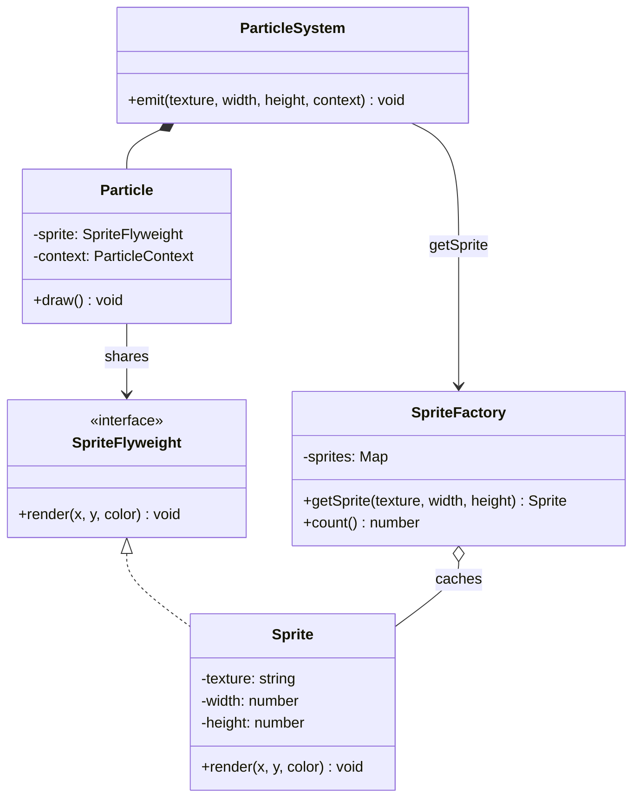

# Yengilvazn andozasi (Flyweight)

<CoverImage src="/covers/structural/flyweight.webp" alt="Cover">
  <h1>Yengilvazn</h1>
  <p>Mingta mitti nurli svetlyachok-robotlar to'dasi — ularning har biri alohida og'ir batareyaga ega bo'lish o'rniga, ingichka nurli chiziqlar orqali markazdagi yagona ulkan batareya blokini baham ko'rmoqda.</p>
</CoverImage>

## Umumiy ko'rinish (Overview)

**Yengilvazn (Flyweight)** — bu obyektlarning umumiy holatini ko'plab nusxalar o'rtasida baham ko'rish orqali xotira sarfini kamaytiruvchi tuzilmaviy (structural) loyihalash andozasidir. Hamma narsani har bir obyektda saqlash o'rniga, Yengilvazn holatni quyidagilarga ajratadi:

- **Ichki holat (Intrinsic state)**: umumiy, barqaror, qayta ishlatiladigan ma'lumotlar
- **Tashqi holat (Extrinsic state)**: kerak bo'lganda uzatiladigan, kontekstga xos ma'lumotlar

**Asosiy afzalligi**: Qimmat, takrorlanuvchi qismni baham ko'rish orqali o'xshash obyektlarning ulkan to'plamlarini amalda qo'llash mumkin qiladi.

**Zamonaviy nuqtai nazar**: Yengilvazn grafik dvigatellarda, matn renderingida, o'yinlarda va katta hajmli UI tizimlarida hali ham muhim. Ko'plab o'xshash obyektlar yaratadigan har qanday ish yuklamasi umumiy o'zgarmas (immutable) holatdan foyda ko'radi.

Yengilvazn kirishni nazorat qilish haqida emas. U ma'lumotlarni samarali baham ko'rish haqida.

## Hayotiy o'xshatish (Real-World Analogy)

**Shrift gliflari kutubxonasini** tasavvur qiling. Muayyan shrift va o'lchamdagi `A` harfining shakli umumiy. Bu glifdan foydalanadigan har bir joyga shaklning yangi nusxasi kerak emas. Faqat uning joylashuvi, rangi va qator konteksti o'zgaradi.

Amaldagi Yengilvazn shunday: bitta umumiy shakl, ko'plab joylashuvlar.

## Tuzilma (Structure)



- **`Sprite`** (Flyweight) o'zgarmas, umumiy **ichki (intrinsic)** holatni (tekstura, o'lcham) saqlaydi.
- **`SpriteFactory`** (Flyweight Factory) sprite'larni kalit bo'yicha keshlaydi va iloji boricha mavjud nusxani qaytaradi.
- **`Particle`** (Context) har bir obyektga xos **tashqi (extrinsic)** holatni (joylashuv, rang, tezlik) saqlaydi va uni `render()`'ga uzatadi.
- **`ParticleSystem`** (Client) oz sonli sprite'larni baham ko'radigan ko'plab zarrachalarni yaratadi.

## Muammo (The Problem)

100 000 ta zarrachani chizadigan o'yinni yoki yuz minglab uslublangan belgilarni chizadigan hujjat muharririni tasavvur qiling. Agar har bir obyekt o'zining barcha formatlash yoki mesh ma'lumotlarini mustaqil saqlasa, xotira sarfi tezda keskin oshib ketadi.

### Muammo misoli

```typescript
// ❌ Yomon: har bir zarracha bir xil tekstura metama'lumotlarini saqlaydi
class Particle {
  constructor(
    public texture: string,
    public width: number,
    public height: number,
    public color: string,
    public x: number,
    public y: number,
  ) {}
}
```

Agar minglab zarrachalar bir xil tekstura va o'lchamlarga ega bo'lsa, bu takrorlanuvchi ma'lumotlar har bir obyektda nusxalanmasligi kerak.

## Yechim (The Solution)

Yengilvazn bu muammoni quyidagicha hal qiladi:

1. Obyekt holatining umumiy qismini aniqlaydi
2. Bu umumiy holatni o'zgarmas yengilvazn obyektlarda saqlaydi
3. O'zgaruvchan kontekstni yengilvazn obyektdan tashqarida saqlaydi
4. Yengilvazn obyektlarni fabrika yoki kesh orqali qayta ishlatadi
5. Chizish yoki qayta ishlash paytida tashqi holatni uzatadi

## Amalga oshirish (Implementation)

::: code-group

```typescript [TypeScript]
interface SpriteFlyweight {
  render(x: number, y: number, color: string): void;
}

class Sprite implements SpriteFlyweight {
  constructor(
    private readonly texture: string,
    private readonly width: number,
    private readonly height: number,
  ) {}

  render(x: number, y: number, color: string): void {
    console.log(
      `Rendering ${this.texture} at (${x}, ${y}) with ${this.width}x${this.height} and color ${color}`,
    );
  }
}

class SpriteFactory {
  private readonly sprites = new Map<string, Sprite>();

  getSprite(texture: string, width: number, height: number): Sprite {
    const key = `${texture}:${width}:${height}`;
    const existing = this.sprites.get(key);
    if (existing) {
      return existing;
    }

    const sprite = new Sprite(texture, width, height);
    this.sprites.set(key, sprite);
    return sprite;
  }

  count(): number {
    return this.sprites.size;
  }
}

interface ParticleContext {
  x: number;
  y: number;
  color: string;
  velocityX: number;
  velocityY: number;
}

class Particle {
  constructor(
    private readonly sprite: SpriteFlyweight,
    private readonly context: ParticleContext,
  ) {}

  draw(): void {
    this.sprite.render(this.context.x, this.context.y, this.context.color);
  }
}

class ParticleSystem {
  private readonly particles: Particle[] = [];

  constructor(private readonly factory: SpriteFactory) {}

  emit(
    texture: string,
    width: number,
    height: number,
    context: ParticleContext,
  ): void {
    const sprite = this.factory.getSprite(texture, width, height);
    this.particles.push(new Particle(sprite, context));
  }

  renderAll(): void {
    for (const particle of this.particles) {
      particle.draw();
    }
  }
}

const factory = new SpriteFactory();
const system = new ParticleSystem(factory);

for (let i = 0; i < 3; i++) {
  system.emit("spark.png", 32, 32, {
    x: 100 + i * 5,
    y: 200 + i * 3,
    color: "orange",
    velocityX: 1.5,
    velocityY: -0.2,
  });
}

system.emit("smoke.png", 64, 64, {
  x: 140,
  y: 240,
  color: "gray",
  velocityX: 0.2,
  velocityY: 0.8,
});

system.renderAll();
console.log(`Unique flyweights: ${factory.count()}`);
```

```python [Python]
from abc import ABC, abstractmethod

class SpriteFlyweight(ABC):
    @abstractmethod
    def render(self, x: int, y: int, color: str) -> None:
        pass

class Sprite(SpriteFlyweight):
    def __init__(self, texture: str, width: int, height: int):
        self._texture = texture
        self._width = width
        self._height = height

    def render(self, x: int, y: int, color: str) -> None:
        print(
            f"Rendering {self._texture} at ({x}, {y}) with {self._width}x{self._height} and color {color}"
        )

class SpriteFactory:
    def __init__(self):
        self._sprites = {}

    def get_sprite(self, texture: str, width: int, height: int) -> Sprite:
        key = f"{texture}:{width}:{height}"
        if key not in self._sprites:
            self._sprites[key] = Sprite(texture, width, height)
        return self._sprites[key]

    def count(self) -> int:
        return len(self._sprites)

class Particle:
    def __init__(self, sprite: SpriteFlyweight, context):
        self._sprite = sprite
        self._context = context

    def draw(self) -> None:
        self._sprite.render(self._context["x"], self._context["y"], self._context["color"])

class ParticleSystem:
    def __init__(self, factory: SpriteFactory):
        self._factory = factory
        self._particles = []

    def emit(self, texture: str, width: int, height: int, context: dict) -> None:
        sprite = self._factory.get_sprite(texture, width, height)
        self._particles.append(Particle(sprite, context))

    def render_all(self) -> None:
        for particle in self._particles:
            particle.draw()

factory = SpriteFactory()
system = ParticleSystem(factory)

for i in range(3):
    system.emit(
        "spark.png",
        32,
        32,
        {"x": 100 + i * 5, "y": 200 + i * 3, "color": "orange", "velocity_x": 1.5, "velocity_y": -0.2},
    )

system.emit(
    "smoke.png",
    64,
    64,
    {"x": 140, "y": 240, "color": "gray", "velocity_x": 0.2, "velocity_y": 0.8},
)

system.render_all()
print(f"Unique flyweights: {factory.count()}")
```

```java [Java]
interface SpriteFlyweight {
    void render(int x, int y, String color);
}

class Sprite implements SpriteFlyweight {
    private final String texture;
    private final int width;
    private final int height;

    Sprite(String texture, int width, int height) {
        this.texture = texture;
        this.width = width;
        this.height = height;
    }

    @Override
    public void render(int x, int y, String color) {
        System.out.println(
            "Rendering " + texture + " at (" + x + ", " + y + ") with " + width + "x" + height + " and color " + color
        );
    }
}

class SpriteFactory {
    private final java.util.Map<String, Sprite> sprites = new java.util.HashMap<>();

    Sprite getSprite(String texture, int width, int height) {
        String key = texture + ":" + width + ":" + height;
        return sprites.computeIfAbsent(key, ignored -> new Sprite(texture, width, height));
    }

    int count() {
        return sprites.size();
    }
}

class Particle {
    private final SpriteFlyweight sprite;
    private final int x;
    private final int y;
    private final String color;

    Particle(SpriteFlyweight sprite, int x, int y, String color) {
        this.sprite = sprite;
        this.x = x;
        this.y = y;
        this.color = color;
    }

    void draw() {
        sprite.render(x, y, color);
    }
}

class ParticleSystem {
    private final java.util.List<Particle> particles = new java.util.ArrayList<>();
    private final SpriteFactory factory;

    ParticleSystem(SpriteFactory factory) {
        this.factory = factory;
    }

    void emit(String texture, int width, int height, int x, int y, String color) {
        particles.add(new Particle(factory.getSprite(texture, width, height), x, y, color));
    }

    void renderAll() {
        for (Particle particle : particles) {
            particle.draw();
        }
    }
}
```

```go [Go]
package main

import "fmt"

type SpriteFlyweight interface {
	Render(x, y int, color string)
}

type Sprite struct {
	texture string
	width   int
	height  int
}

func (s *Sprite) Render(x, y int, color string) {
	fmt.Printf("Rendering %s at (%d, %d) with %dx%d and color %s\n", s.texture, x, y, s.width, s.height, color)
}

type SpriteFactory struct {
	sprites map[string]*Sprite
}

func NewSpriteFactory() *SpriteFactory {
	return &SpriteFactory{sprites: make(map[string]*Sprite)}
}

func (f *SpriteFactory) GetSprite(texture string, width, height int) *Sprite {
	key := fmt.Sprintf("%s:%d:%d", texture, width, height)
	if sprite, ok := f.sprites[key]; ok {
		return sprite
	}
	created := &Sprite{texture: texture, width: width, height: height}
	f.sprites[key] = created
	return created
}

type Particle struct {
	sprite SpriteFlyweight
	x      int
	y      int
	color  string
}

func (p *Particle) Draw() {
	p.sprite.Render(p.x, p.y, p.color)
}

type ParticleSystem struct {
	factory   *SpriteFactory
	particles []*Particle
}

func NewParticleSystem(factory *SpriteFactory) *ParticleSystem {
	return &ParticleSystem{factory: factory}
}

func (s *ParticleSystem) Emit(texture string, width, height, x, y int, color string) {
	sprite := s.factory.GetSprite(texture, width, height)
	s.particles = append(s.particles, &Particle{sprite: sprite, x: x, y: y, color: color})
}

func (s *ParticleSystem) RenderAll() {
	for _, particle := range s.particles {
		particle.Draw()
	}
}
```

```rust [Rust]
use std::collections::HashMap;
use std::sync::Arc;

trait SpriteFlyweight {
  fn render(&self, x: i32, y: i32, color: &str);
}

struct Sprite {
  texture: String,
  width: i32,
  height: i32,
}

impl SpriteFlyweight for Sprite {
  fn render(&self, x: i32, y: i32, color: &str) {
    println!(
      "Rendering {} at ({}, {}) with {}x{} and color {}",
      self.texture, x, y, self.width, self.height, color
    );
  }
}

struct SpriteFactory {
  sprites: HashMap<String, Arc<Sprite>>,
}

impl SpriteFactory {
  fn new() -> Self {
    Self {
      sprites: HashMap::new(),
    }
  }

  fn get_sprite(&mut self, texture: &str, width: i32, height: i32) -> Arc<Sprite> {
    let key = format!("{}:{}:{}", texture, width, height);
    self.sprites
      .entry(key)
      .or_insert_with(|| {
        Arc::new(Sprite {
          texture: texture.to_string(),
          width,
          height,
        })
      })
      .clone()
  }

  fn count(&self) -> usize {
    self.sprites.len()
  }
}

struct Particle {
  sprite: Arc<Sprite>,
  x: i32,
  y: i32,
  color: String,
}

impl Particle {
  fn draw(&self) {
    self.sprite.render(self.x, self.y, &self.color);
  }
}

struct ParticleSystem {
  particles: Vec<Particle>,
}

impl ParticleSystem {
  fn new() -> Self {
    Self { particles: Vec::new() }
  }

  fn emit(&mut self, sprite: Arc<Sprite>, x: i32, y: i32, color: String) {
    self.particles.push(Particle { sprite, x, y, color });
  }

  fn render_all(&self) {
    for particle in &self.particles {
      particle.draw();
    }
  }
}

fn main() {
  let mut factory = SpriteFactory::new();
  let mut system = ParticleSystem::new();

  let spark = factory.get_sprite("spark.png", 32, 32);
  let smoke = factory.get_sprite("smoke.png", 64, 64);

  system.emit(spark.clone(), 100, 200, "orange".to_string());
  system.emit(spark.clone(), 110, 210, "orange".to_string());
  system.emit(smoke.clone(), 140, 240, "gray".to_string());

  system.render_all();
  println!("Unique flyweights: {}", factory.count());
}
```

:::

## Haqiqiy hayotdagi misol (Real-World Example)

Sprite tizimi Yengilvazn uchun juda mos, chunki ko'plab nusxalar bir xil tekstura metama'lumotlarini baham ko'radi, lekin joylashuvi, rang tusi (tint) yoki tezligi bilan farq qiladi. Umumiy sprite ma'lumotlari fabrikada qoladi, zarracha yoki obyekt (entity) esa faqat kontekstni saqlaydi.

Bu katta sahnalarni xotira jihatidan ancha samarali qiladi.

```typescript
const factory = new SpriteFactory();
const system = new ParticleSystem(factory);

system.emit("spark.png", 32, 32, {
  x: 100,
  y: 200,
  color: "orange",
  velocityX: 1.5,
  velocityY: -0.2,
});
system.emit("spark.png", 32, 32, {
  x: 110,
  y: 210,
  color: "orange",
  velocityX: 1.2,
  velocityY: -0.1,
});
```

## Afzalliklari (Advantages)

- Katta obyektlar to'plamlari uchun xotira sarfini kamaytiradi
- Umumiy o'zgarmas holatni markazlashtiradi
- Takrorlanuvchi ma'lumotlar uchun kesh lokalligini (cache locality) yaxshilaydi
- Katta to'plamlarni amaliyroq qiladi
- Umumiy va kontekstual ma'lumotlarni ajratishni rag'batlantiradi
- Rendering va simulyatsiya ish yuklamalari uchun yaxshi ishlaydi

## Kamchiliklari (Disadvantages)

- Holatni ikki qismga ajratish orqali murakkablik qo'shadi
- Ortiqcha ishlatilsa, API'larni noqulayroq qiladi
- Fabrika yoki kesh qatlamini talab qiladi
- Tashqi holat katta bo'lganda noqulay bo'lishi mumkin
- Umumiy holatni debug qilish qo'shimcha ehtiyotkorlik talab qiladi

## Qachon foydalanish kerak (When to Use)

- Sizda juda ko'p sonli o'xshash obyektlar bor
- Holatning katta qismini xavfsiz baham ko'rish mumkin
- O'zgaruvchan qismni kontekst sifatida uzatish mumkin
- Xotira sarfi haqiqiy muammo
- Grafika, matn renderingi yoki simulyatsiya tizimlarini yaratyapsiz

## Qachon foydalanmaslik kerak (When NOT to Use)

- Obyektlar kam va ularni yaratish arzon
- Holatning katta qismi har bir obyekt uchun noyob
- Kontekst umumiy holatdan murakkabroq
- Soddalik xotirani tejashdan muhimroq
- Baham ko'rish mantig'ini qo'llab-quvvatlash tejalgan xotiraga arzimaydi

## Keng tarqalgan xatolar (Common Mistakes)

### 1-xato: Tashqi holatni yengilvazn obyekt ichiga joylash

```typescript
// ❌ Yomon: har bir sprite x va y ni saqlaydi
class BadSprite {
  constructor(
    public x: number,
    public y: number,
  ) {}
}

// ✅ Yaxshi: pozitsiya umumiy obyektda emas, kontekstda bo'ladi
```

### 2-xato: Yengilvazn obyektlarni qayta ishlatmaslik

```typescript
// ❌ Yomon: har doim yangi sprite yaratish
const sprite = new Sprite("spark.png", 32, 32);

// ✅ Yaxshi: umumiy nusxalarni factory'dan so'rang
```

### 3-xato: Yengilvazn obyektlarni o'zgaruvchan (mutable) qilish

```typescript
// ❌ Yomon: umumiy holat buzilishi mumkin
class BadFlyweight {
  setTexture(texture: string) {}
}

// ✅ Yaxshi: yengilvazn obyektlarni o'zgarmas saqlang
```

### 4-xato: Obyektlar takrorlanmaydigan holatda Yengilvazndan foydalanish

```typescript
// ❌ Yomon: har bir obyekt noyob bo'lganda ulashishni qo'llash
// ✅ Yaxshi: uni ko'p takrorlanadigan shakllar uchun saqlang
```

## Aloqador andozalar (Related Patterns)

- **[Fabrika metodi](/uz/creational/factory-method)**: Ko'pincha yengilvazn obyektlarni yaratish yoki olish uchun ishlatiladi
- **[Singleton](/uz/creational/singleton)**: Yengilvazn fabrikalari ba'zan singleton bo'ladi
- **[Kompozit](/uz/structural/composite)**: Yengilvazn obyektlarni daraxtsimon tuzilmalarda saqlashi mumkin
- **[O'rinbosar](/uz/structural/proxy)**: O'ramga o'xshash shaklga ega, lekin maqsadi boshqa

## Zamonaviy muqobillar (Modern Alternatives)

- Strukturaviy ulashishga (structural sharing) ega o'zgarmas value obyektlar
- Dvigatel darajasidagi resurs keshlari
- Grafik tizimlardagi GPU instancing
- Takrorlanishlardan tozalangan matn/glif buferlari
- Unumdorlikka sezgir tizimlardagi arena allocator'lar yoki obyektlar havzalari (object pool)

## Intervyu uchun maslahatlar (Interview Insights)

**1-savol: Yengilvaznning asosiy g'oyasi nima?**

J: Ichki holatni ko'plab o'xshash obyektlar o'rtasida baham ko'rish va tashqi holatni obyektdan tashqarida saqlash.

**2-savol: Ichki va tashqi holat o'rtasidagi farq nima?**

J: Ichki holat umumiy va barqaror. Tashqi holat har bir foydalanishda o'zgaradi va kontekst sifatida uzatiladi.

**3-savol: Yengilvazn qachon o'z murakkabligiga arziydi?**

J: Ko'plab takrorlanuvchi obyektlar bo'lganda va xotira bosimi sezilarli bo'lganda.

**4-savol: Nega yengilvazn obyektlar o'zgarmas bo'lishi kerak?**

J: Chunki ular baham ko'riladi. Agar bitta chaqiruvchi ularni o'zgartirsa, boshqa barcha chaqiruvchilar ham bu o'zgarishni ko'radi.

**5-savol: Yengilvazn Obyektlar havzasi (Object Pool) andozasidan nimasi bilan farq qiladi?**

J: Obyektlar havzasi butun obyektlarni hayot sikli va unumdorlik sabablari uchun qayta ishlatadi. Yengilvazn esa holatning barqaror qismini ko'plab mantiqiy obyektlar o'rtasida baham ko'radi.
