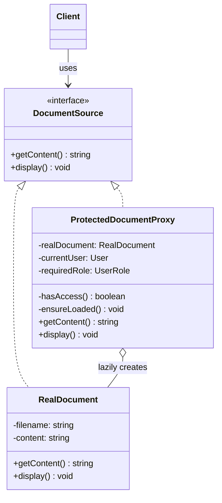

# Proxy Pattern

<CoverImage src="/covers/structural/proxy.webp" alt="Cover">
  <h1>Proxy</h1>
  <p>Quyosh ko'zoynagi va smoking kiygan ulkan, qo'rqinchli qo'riqchi-robot darvozani to'sib turibdi va mitti, hayajonlangan robotning hujjatlarini tekshirib, shundan keyingina uni ortidagi asosiy superkompyuter bilan gaplashishga qo'yib yubormoqda.</p>
</CoverImage>

## Umumiy ko'rinish (Overview)

**Proxy** — bu boshqa obyekt uchun o'rinbosar obyekt taqdim etuvchi strukturaviy (structural) dizayn patternidir, shunda unga kirishni nazorat qilish, kechiktirish, kuzatish yoki o'zgartirish mumkin bo'ladi. Proxy haqiqiy obyekt bilan bir xil interfeysni amalga oshiradi, lekin uning atrofiga qo'shimcha qatlam qo'shadi.

**Asosiy afzalligi**: Qimmat yoki maxfiy obyektlarni ulardan foydalanadigan mijoz kodini o'zgartirmasdan boshqarish imkonini beradi.

**Zamonaviy nuqtai nazar**: Proxy masofaviy servislarda, kechiktirib yuklanadigan (lazy-loaded) resurslarda, avtorizatsiya darvozalarida, keshlash qatlamlarida va SDK o'ramlarida hali ham keng tarqalgan. Bu infratuzilma kodi uchun eng amaliy patternlardan biri.

Proxy interfeys tarjimasi haqida emas, kirishni nazorat qilish haqida.

## Hayotiy o'xshatish (Real-World Analogy)

**Maxfiy arxivdagi qo'riqchini** tasavvur qiling. Tashrif buyuruvchilar to'g'ridan-to'g'ri omborxonaga kirmaydi. Qo'riqchi ruxsatlarni tekshiradi, eshikni ochish-ochmaslikni hal qiladi va shundan keyingina tashrif buyuruvchiga arxivni ko'rishga ruxsat beradi.

Qo'riqchi — proxy. Arxiv — haqiqiy obyekt.

## Tuzilma (Structure)



- **`DocumentSource`** (Subject) — haqiqiy obyekt va proxy uchun umumiy interfeys.
- **`RealDocument`** (Real Subject) kontentni diskdan yuklashdek qimmat ishni bajaradi.
- **`ProtectedDocumentProxy`** (Proxy) kirishni tekshiradi, haqiqiy hujjatni faqat birinchi foydalanishda yaratadi, so'ngra ishni unga topshiradi.
- **`Client`** `DocumentSource` bilan ishlaydi va o'zida proxy yoki haqiqiy obyekt borligini farqlay olmaydi.

## Muammo (The Problem)

Ba'zi obyektlar qimmat, maxfiy yoki ikkalasi ham:

- faqat kerak bo'lganda yuklanishi kerak bo'lgan katta hujjatlar
- o'qishdan oldin ruxsat talab qiladigan yozuvlar
- tarmoq chegarasi orqali murojaat qilinishi kerak bo'lgan masofaviy obyektlar
- kuzatish yoki keshlashni talab qiladigan resurslar

Agar mijoz bu obyektlarni to'g'ridan-to'g'ri yaratsa va ular bilan bevosita muloqot qilsa, ular qachon yuklanishi va kimga ularga kirishga ruxsat berilishi ustidan nazoratni yo'qotasiz.

### Muammo misoli

```typescript
// ❌ Yomon: mijoz yuklash va avtorizatsiyani o'zi boshqaradi
const document = new RealDocument("annual-report.pdf");
if (user.role !== "admin") {
  throw new Error("Access denied");
}
console.log(document.getContent());
```

Bu siyosat (policy) va yuklash vazifalarini har bir chaqiruvchiga tarqatib yuboradi.

## Yechim (The Solution)

Proxy haqiqiy obyekt oldiga nazorat qilinadigan obyektni joylashtirish orqali bu muammoni hal qiladi.

1. Umumiy interfeysni aniqlang
2. Haqiqiy obyektni alohida amalga oshiring
3. Haqiqiy obyektni kechiktirib (lazy) saqlaydigan proxy'ni amalga oshiring
4. Avtorizatsiya, keshlash, loglash yoki masofaviy kirish mantig'ini proxy'ga joylang
5. Mijozni bu farqdan bexabar qoldiring

## Amalga oshirish (Implementation)

::: code-group

```typescript [TypeScript]
interface DocumentSource {
  getContent(): string;
  display(): void;
}

class RealDocument implements DocumentSource {
  private content: string;

  constructor(private readonly filename: string) {
    this.content = this.loadFromDisk();
  }

  private loadFromDisk(): string {
    console.log(`Loading document from disk: ${this.filename}`);
    return `Content of ${this.filename}`;
  }

  getContent(): string {
    return this.content;
  }

  display(): void {
    console.log(this.content);
  }
}

type UserRole = "guest" | "user" | "admin";

interface User {
  name: string;
  role: UserRole;
}

class ProtectedDocumentProxy implements DocumentSource {
  private realDocument: RealDocument | null = null;

  constructor(
    private readonly filename: string,
    private readonly currentUser: User,
    private readonly requiredRole: UserRole,
  ) {}

  private hasAccess(): boolean {
    const rank: Record<UserRole, number> = { guest: 1, user: 2, admin: 3 };
    return rank[this.currentUser.role] >= rank[this.requiredRole];
  }

  private ensureLoaded(): void {
    if (!this.realDocument) {
      this.realDocument = new RealDocument(this.filename);
    }
  }

  getContent(): string {
    if (!this.hasAccess()) {
      throw new Error(`Access denied for ${this.currentUser.name}`);
    }

    this.ensureLoaded();
    return this.realDocument.getContent();
  }

  display(): void {
    if (!this.hasAccess()) {
      throw new Error(`Access denied for ${this.currentUser.name}`);
    }

    this.ensureLoaded();
    this.realDocument.display();
  }
}

const admin: User = { name: "Alice", role: "admin" };
const guest: User = { name: "Bob", role: "guest" };

const protectedDoc = new ProtectedDocumentProxy(
  "annual-report.pdf",
  admin,
  "admin",
);
console.log(protectedDoc.getContent());

const deniedDoc = new ProtectedDocumentProxy(
  "annual-report.pdf",
  guest,
  "admin",
);
// deniedDoc.getContent(); // kirish rad etilgani haqida xato tashlaydi
```

```python [Python]
from abc import ABC, abstractmethod

class DocumentSource(ABC):
    @abstractmethod
    def get_content(self) -> str:
        pass

    @abstractmethod
    def display(self) -> None:
        pass

class RealDocument(DocumentSource):
    def __init__(self, filename: str):
        self._filename = filename
        self._content = self._load_from_disk()

    def _load_from_disk(self) -> str:
        print(f"Loading document from disk: {self._filename}")
        return f"Content of {self._filename}"

    def get_content(self) -> str:
        return self._content

    def display(self) -> None:
        print(self._content)

class User:
    def __init__(self, name: str, role: str):
        self.name = name
        self.role = role

class ProtectedDocumentProxy(DocumentSource):
    def __init__(self, filename: str, current_user: User, required_role: str):
        self._filename = filename
        self._current_user = current_user
        self._required_role = required_role
        self._real_document = None

    def _has_access(self) -> bool:
        rank = {"guest": 1, "user": 2, "admin": 3}
        return rank.get(self._current_user.role, 0) >= rank.get(self._required_role, 0)

    def _ensure_loaded(self) -> None:
        if self._real_document is None:
            self._real_document = RealDocument(self._filename)

    def get_content(self) -> str:
        if not self._has_access():
            raise PermissionError(f"Access denied for {self._current_user.name}")

        self._ensure_loaded()
        return self._real_document.get_content()

    def display(self) -> None:
        if not self._has_access():
            raise PermissionError(f"Access denied for {self._current_user.name}")

        self._ensure_loaded()
        self._real_document.display()

admin = User("Alice", "admin")
guest = User("Bob", "guest")

protected_doc = ProtectedDocumentProxy("annual-report.pdf", admin, "admin")
print(protected_doc.get_content())

# denied_doc = ProtectedDocumentProxy("annual-report.pdf", guest, "admin")
# denied_doc.get_content()
```

```java [Java]
interface DocumentSource {
    String getContent();
    void display();
}

class RealDocument implements DocumentSource {
    private final String filename;
    private final String content;

    RealDocument(String filename) {
        this.filename = filename;
        this.content = loadFromDisk();
    }

    private String loadFromDisk() {
        System.out.println("Loading document from disk: " + filename);
        return "Content of " + filename;
    }

    @Override
    public String getContent() {
        return content;
    }

    @Override
    public void display() {
        System.out.println(content);
    }
}

enum Role {
    GUEST, USER, ADMIN
}

class User {
    final String name;
    final Role role;

    User(String name, Role role) {
        this.name = name;
        this.role = role;
    }
}

class ProtectedDocumentProxy implements DocumentSource {
    private final String filename;
    private final User currentUser;
    private final Role requiredRole;
    private RealDocument realDocument;

    ProtectedDocumentProxy(String filename, User currentUser, Role requiredRole) {
        this.filename = filename;
        this.currentUser = currentUser;
        this.requiredRole = requiredRole;
    }

    private boolean hasAccess() {
        return currentUser.role.ordinal() >= requiredRole.ordinal();
    }

    private void ensureLoaded() {
        if (realDocument == null) {
            realDocument = new RealDocument(filename);
        }
    }

    @Override
    public String getContent() {
        if (!hasAccess()) {
            throw new SecurityException("Access denied for " + currentUser.name);
        }

        ensureLoaded();
        return realDocument.getContent();
    }

    @Override
    public void display() {
        if (!hasAccess()) {
            throw new SecurityException("Access denied for " + currentUser.name);
        }

        ensureLoaded();
        realDocument.display();
    }
}
```

```go [Go]
package main

import "fmt"

type DocumentSource interface {
	GetContent() string
	Display()
}

type RealDocument struct {
	filename string
	content  string
}

func NewRealDocument(filename string) *RealDocument {
	return &RealDocument{
		filename: filename,
		content:  loadFromDisk(filename),
	}
}

func loadFromDisk(filename string) string {
	fmt.Println("Loading document from disk:", filename)
	return "Content of " + filename
}

func (d *RealDocument) GetContent() string { return d.content }
func (d *RealDocument) Display()           { fmt.Println(d.content) }

type User struct {
	Name string
	Role string
}

type ProtectedDocumentProxy struct {
	filename     string
	currentUser  User
	requiredRole string
	realDocument *RealDocument
}

func NewProtectedDocumentProxy(filename string, currentUser User, requiredRole string) *ProtectedDocumentProxy {
	return &ProtectedDocumentProxy{filename: filename, currentUser: currentUser, requiredRole: requiredRole}
}

func roleRank(role string) int {
	ranks := map[string]int{"guest": 1, "user": 2, "admin": 3}
	return ranks[role]
}

func (p *ProtectedDocumentProxy) hasAccess() bool {
	return roleRank(p.currentUser.Role) >= roleRank(p.requiredRole)
}

func (p *ProtectedDocumentProxy) ensureLoaded() {
	if p.realDocument == nil {
		p.realDocument = NewRealDocument(p.filename)
	}
}

func (p *ProtectedDocumentProxy) GetContent() string {
	if !p.hasAccess() {
		panic("access denied for " + p.currentUser.Name)
	}
	p.ensureLoaded()
	return p.realDocument.GetContent()
}

func (p *ProtectedDocumentProxy) Display() {
	if !p.hasAccess() {
		panic("access denied for " + p.currentUser.Name)
	}
	p.ensureLoaded()
	p.realDocument.Display()
}
```

```rust [Rust]
trait DocumentSource {
    fn get_content(&mut self) -> String;
    fn display(&mut self);
}

struct RealDocument {
    filename: String,
    content: String,
}

impl RealDocument {
    fn new(filename: String) -> Self {
        let content = Self::load_from_disk(&filename);
        Self { filename, content }
    }

    fn load_from_disk(filename: &str) -> String {
        println!("Loading document from disk: {}", filename);
        format!("Content of {}", filename)
    }
}

impl DocumentSource for RealDocument {
    fn get_content(&mut self) -> String {
        self.content.clone()
    }

    fn display(&mut self) {
        println!("{}", self.content);
    }
}

#[derive(Clone)]
struct User {
    name: String,
    role: String,
}

struct ProtectedDocumentProxy {
    filename: String,
    current_user: User,
    required_role: String,
    real_document: Option<RealDocument>,
}

impl ProtectedDocumentProxy {
    fn new(filename: String, current_user: User, required_role: String) -> Self {
        Self {
            filename,
            current_user,
            required_role,
            real_document: None,
        }
    }

    fn rank(role: &str) -> i32 {
        match role {
            "guest" => 1,
            "user" => 2,
            "admin" => 3,
            _ => 0,
        }
    }

    fn has_access(&self) -> bool {
        Self::rank(&self.current_user.role) >= Self::rank(&self.required_role)
    }

    fn ensure_loaded(&mut self) {
        if self.real_document.is_none() {
            self.real_document = Some(RealDocument::new(self.filename.clone()));
        }
    }
}

impl DocumentSource for ProtectedDocumentProxy {
    fn get_content(&mut self) -> String {
        if !self.has_access() {
            panic!("access denied for {}", self.current_user.name);
        }

        self.ensure_loaded();
        self.real_document.as_mut().unwrap().get_content()
    }

    fn display(&mut self) {
        if !self.has_access() {
            panic!("access denied for {}", self.current_user.name);
        }

        self.ensure_loaded();
        self.real_document.as_mut().unwrap().display();
    }
}
```

:::

## Haqiqiy hayotdagi misol (Real-World Example)

Hujjatlar platformasidagi amaliy proxy maxfiy fayllarga kirishni himoya qilib, ularni faqat kerak bo'lganda yuklashi mumkin. Mijoz shunchaki hujjat manbasini so'raydi; proxy ruxsatlarni tekshiradi va haqiqiy hujjatni kechiktirib ishga tushiradi.

```typescript
const doc = new ProtectedDocumentProxy(
  "annual-report.pdf",
  { name: "Alice", role: "admin" },
  "admin",
);

console.log(doc.getContent());
```

Bu haqiqiy obyekt qimmat, masofaviy yoki maxfiy bo'lganda foydali.

## Afzalliklari (Advantages)

- Mijoz kodini o'zgartirmasdan kirishni nazorat qiladi
- Qimmat obyektlarni kechiktirib yuklashni (lazy loading) qo'llab-quvvatlaydi
- Avtorizatsiya yoki validatsiyani markazlashtiradi
- Keshlash, loglash yoki monitoring qo'shishi mumkin
- Haqiqiy obyektni o'zining asosiy ishiga yo'naltirilgan holda saqlaydi
- Masofaviy yoki og'ir resurslar uchun yaxshi ishlaydi

## Kamchiliklari (Disadvantages)

- Yana bir bilvosita (indirection) qatlam qo'shadi
- Xatti-harakatni yashirib, debug qilishni qiyinlashtirishi mumkin
- Umumiy (shared) proxy'lar uchun ehtiyotkorlik bilan sinxronlashni talab qiladi
- Juda ko'p vazifalarni bajarsa, murakkab bo'lib qolishi mumkin
- Arzon obyektlar uchun qo'shimcha o'ram kodi keraksiz

## Qachon foydalanish kerak (When to Use)

- Haqiqiy obyektni yaratish qimmat
- Kirishni nazorat qilish yoki tekshirish kerak
- Kechiktirib yuklash (lazy loading) kerak
- Sizga masofaviy obyekt chegarasi kerak
- Loglash yoki keshlashni shaffof tarzda qo'shmoqchisiz

## Qachon foydalanmaslik kerak (When NOT to Use)

- Obyekt yengil va doimo kerak
- Proxy juda ko'p biznes mantig'ini takrorlab qo'yadi
- Soddalik kirishni nazorat qilishdan muhimroq
- Qo'shimcha bilvositalik o'qilishni yomonlashtiradi
- Proxy va haqiqiy obyekt bir-biridan juda uzoqlashib ketadi

## Keng tarqalgan xatolar (Common Mistakes)

### 1-xato: Biznes mantig'ini proxy'ga joylash

```typescript
// ❌ Yomon: domen qoidalari proxy'ga tegishli
class BadProxy {
  getContent() {
    // narxlash, formatlash va siyosat shu yerda
  }
}

// ✅ Yaxshi: proxy kirishni nazorat qiladi, xatti-harakat haqiqiy obyektga tegishli
```

### 2-xato: Qimmat obyektlarni oldindan (eager) yuklash

```typescript
// ❌ Yomon: lazy loading yo'q
const doc = new RealDocument("big.pdf");

// ✅ Yaxshi: yaratishni kerak bo'lgunicha kechiktiring
```

### 3-xato: Haqiqiy obyektga to'g'ridan-to'g'ri kirishni sizdirish

```typescript
// ❌ Yomon: mijozlar proxy'ni chetlab o'tadi
class BadProxy {
  getRealDocument() {}
}

// ✅ Yaxshi: proxy'ni chegara sifatida saqlang
```

### 4-xato: Proxy'ni Decorator kabi qo'llash

```typescript
// ❌ Yomon: kirishni nazorat qilish maqsadisiz xatti-harakat qo'shish
// ✅ Yaxshi: asosiy maqsad kirishni nazorat qilish bo'lsa, Proxy'dan foydalaning
```

## Aloqador patternlar (Related Patterns)

- **[Decorator](/uz/structural/decorator)**: Mas'uliyatlar qo'shadi; Proxy esa kirishni nazorat qiladi
- **[Adapter](/uz/structural/adapter)**: Bir interfeysni boshqasiga aylantiradi
- **[Facade](/uz/structural/facade)**: Kirishni to'sish o'rniga quyi tizimni soddalashtiradi
- **[Singleton](/uz/creational/singleton)**: Ba'zan bitta proxy nusxasini baham ko'rish uchun ishlatiladi, lekin bu shart emas

## Zamonaviy muqobillar (Modern Alternatives)

- ORM'lardagi kechiktirib yuklanadigan entity'lar
- HTTP klient interceptor'lari va middleware
- API gateway'lar va BFF'lar
- Service mesh'lar va sidecar'lar
- Bulutli IAM / siyosatni majburlash (policy enforcement) qatlamlari

## Intervyu uchun maslahatlar (Interview Insights)

**1-savol: Proxy'ning asosiy maqsadi nima?**

J: Xuddi shu interfeysni amalga oshiruvchi o'rinbosar orqali boshqa obyektga kirishni nazorat qilish.

**2-savol: Proxy Decorator'dan nimasi bilan farq qiladi?**

J: Proxy kirishni nazorat qilish, kechiktirib yuklash yoki masofaviy kirish haqida. Decorator esa xatti-harakat qo'shish haqida.

**3-savol: Nega kechiktirib yuklash Proxy'ning keng tarqalgan qo'llanilishi hisoblanadi?**

J: U qimmat obyektni yaratishni obyekt haqiqatan kerak bo'lgunga qadar kechiktiradi, bu esa ishga tushish xarajatini va xotira sarfini yaxshilaydi.

**4-savol: Proxy'ni xavfsizlik uchun ishlatish mumkinmi?**

J: Ha. Himoya proxy'lari (protection proxies) avtorizatsiya tekshiruvlarini markazlashtirishning standart usuli.

**5-savol: Proxy'dagi eng katta xavf nima?**

J: Uni qo'shimcha vazifalar bilan shu qadar ortiqcha yuklash-ki, oxir-oqibat u haqida mulohaza yuritish haqiqiy obyektning o'zidan ham qiyinroq bo'lib qoladi.
